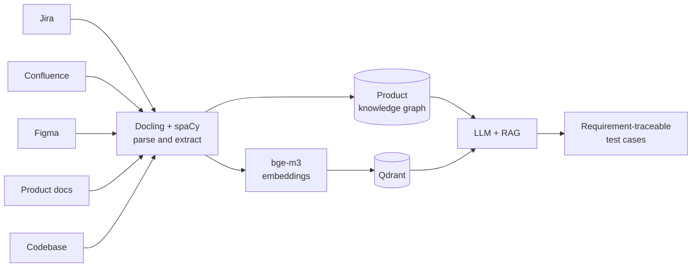

**I build agentic AI systems that turn scattered product knowledge into shipped engineering work — test suites, QA runs, load tests and reports that used to take days.**

---

## ⚡ Right now

- 🏢 **Agentic AI Engineer at [Azentio](https://www.azentio.com/)** (Aug 2026 →), after a 15-month internship on the same team — building LLM agents for test generation, QA and performance engineering.
- 🎓 **B.E. Computer Science, NIE Mysuru** — graduated 2026 with a **9.30 CGPA**.
- 🧪 **Thinking about:** agent evaluation, grounding and guardrails — making agents that refuse to make things up.
- 🤝 **Open to:** collaborating on agentic AI, RAG and evaluation tooling.

---

## 📊 Impact at work

| What I built | Outcome |
|---|---|
| **LLM test-generation pipeline** — unifies Jira, Confluence, Figma, product docs and code into a product knowledge graph, then uses RAG to write requirement-traceable test cases | ⏱️ Test design: **20 days → 2 days** |
| **Sales-sizing app** — turns client transaction volumes and user counts into infrastructure recommendations and PDF reports | ⏱️ Turnaround: **2–3 days → under 1 hour** |
| **LangGraph performance-testing agent** — orchestrates JMeter/k6 workloads with adaptive load scaling | 🎯 Finds SLA breakpoints, analyses app/DB performance, files Jira defects for regressions |
| **Multi-application QA agents** — pick and run the right automated test suites to validate bug fixes, using app knowledge, mapped tests and preflight checks | ✅ Bug-fix validation without hand-picking suites |
| **Cross-editor AI-usage analytics** for Claude Code, GitHub Copilot and Cursor — groups chats by task | 📈 Usage, cost, time and artifact metrics exported to Excel |
| **MERN expense-reimbursement platform** at Prixgen Tech Solutions (Jan–Apr 2025) | ⚙️ Automated **~90%** of internal expense workflows |

<b>🔍 How the test-generation pipeline fits together</b>

 

---

## 🚀 Featured projects

### 🌍 [SafeGround](https://github.com/gahanpradhan?tab=repositories&q=SafeGround) — AI hazard readiness & response planning

A geospatial disaster-readiness platform: give it any location and it profiles hazards, assesses local exposure and prioritises what to prepare. It pulls from **Google Earth Engine, USGS, GDACS and OpenStreetMap**, runs **Google ADK multi-agent workflows** for analysis, research and safety planning, and checks every plan against deterministic hazard zones, routes and official rulebooks — rejecting unsafe advice and unsupported facts.

> **Evaluated on 20 safety-plan cases**
> | Check | SafeGround | Gemini alone |
> |---|:---:|:---:|
> | Danger-level accuracy | **100%** | 30% |
> | Primary-action accuracy | **100%** | 70% |
> | Plans with invented distances/times | **0** | 3 |

### 💬 [Promptly](https://github.com/gahanpradhan?tab=repositories&q=Promptly) — community hub for reusable AI prompts

A place to publish, discover and share AI prompts, with **Elasticsearch full-text search** so good prompts are easy to find and reuse. Built for safe community sharing: **two-factor authentication, role-based access control and multi-level content moderation**.

<b>📁 Earlier projects</b>

 

- **Nomadify** — AI trip planner that generates personalised itineraries from interests and budget, with Google Maps and weather forecasts. *React · Firebase · Gemini · Tailwind · shadcn/ui*
- **JobDash** — job-application tracker with reminders and a visual pipeline. *JavaScript · Flask · PostgreSQL · Docker · Jenkins · Tailwind*

---

## 🧰 Tech stack

| Area | Tools |
|---|---|
| **Languages** |  &nbsp;+ SQL |
| **Agentic AI** |    -8E75B2?style=flat-square&logo=googlegemini&logoColor=white)      RAG · multi-agent orchestration · structured outputs · multimodal extraction |
| **Backend & web** |  &nbsp;+ SQLAlchemy, REST, async |
| **Data & search** |  &nbsp;+ Qdrant, Oracle |
| **Infra & CI** |  |
| **Testing** |     |

---

## 🏆 Achievements

- 🌏 **Google AI Builder Cup 2026** — shortlisted participant in the JAPAC-region AI hackathon
- 🛒 **Flipkart GRiD 7.0** — National Semifinalist, **top 2%** of 160,000+ participants
- 🥈 **CODEMAZE Hackathon, IEEE NIE Mysuru** — 2nd place among 25+ teams
- 🧠 **LeetCode 1632** · **CodeChef 1416 (2★)**
- 🧑‍🏫 Trained **50+ students** at CHIGURU 2024 with Youth For Seva

---

## 📈 Activity

<picture>
  <source media="(prefers-color-scheme: dark)" srcset="https://github-stats-extended.vercel.app/api?username=gahanpradhan&show_icons=true&include_all_commits=true&hide_border=true&theme=tokyonight" />
  
</picture>
<picture>
  <source media="(prefers-color-scheme: dark)" srcset="https://github-stats-extended.vercel.app/api/top-langs/?username=gahanpradhan&layout=compact&langs_count=6&hide_border=true&theme=tokyonight" />
  
</picture>

<picture>
  <source media="(prefers-color-scheme: dark)" srcset="https://streak-stats.demolab.com?user=gahanpradhan&hide_border=true&theme=tokyonight" />
  
</picture>

---

<i>Building agents that earn their trust. Let's talk ⚡</i>

